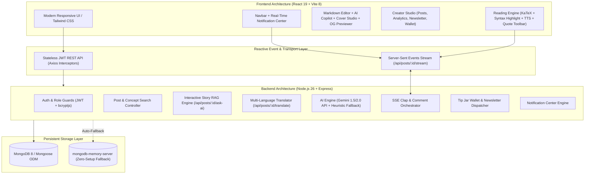

# 🚀 BlogHub v3.0 Enterprise Edition
### *The Next-Generation AI-Native Publishing, Community & Creator Monetization Platform*

[](https://nodejs.org/)
[](https://react.dev/)
[](https://vitejs.dev/)
[](https://expressjs.com/)
[](https://www.mongodb.com/)
[](https://tailwindcss.com/)
[](https://ai.google.dev/)
[](LICENSE)

---

## 📌 Executive Summary

**BlogHub Enterprise Edition** is a modern, reactive, AI-powered publishing platform engineered from the ground up to empower technical writers, software engineers, and digital creators. 

Blending the intuitive authoring ergonomics of **Medium**, the subscriber-first monetization of **Substack**, the community engagement of **Dev.to**, and the contextual intelligence of **Notion AI**, BlogHub delivers:
* **Interactive RAG Intelligence:** Readers can chat directly with any article using contextual grounding.
* **Real-Time Reactive Feeds:** Live claps, appreciations, comments, and tips stream in real time via **Server-Sent Events (SSE)** without page reloads.
* **Creator Monetization Rails:** Instant micro-tipping with wallet crediting and a built-in Substack-style newsletter dispatcher.
* **Deep Telemetry Analytics:** 30-day interactive view velocity charts, scroll completion meters, and referral channels.
* **Zero-Setup Evaluation:** Boots an automated embedded in-memory MongoDB server with rich demo datasets pre-loaded on first launch.

---

## 📸 Live Demonstration & UI Showcase

```
+---------------------------------------------------------------------------------------------------+
|  [Header / Navbar: Search Concepts | Live Notifications (3) | Write Story | Profile | Theme]      |
+---------------------------------------------------------------------------------------------------+
|                                                                                                   |
|  [⚡ HERO ARTICLE]  The Future of Full-Stack Web Development in 2026                             |
|  * 🎧 Listen to Audio (TTS)  |  🌐 Language [EN|ES|FR|DE|JA|HI]  |  📄 Export Clean PDF           |
|  * ✨ Key Takeaways: (3 Bullet-Point AI Summary)                                                  |
|  * 💻 KaTeX Math: $$E=mc^2$$ & Line-Numbered Syntax Highlighting                                  |
|  * 🟡 Medium-Style Text Selection: [𝕏 Share Quote | 💬 Discuss | 📋 Copy]                         |
|                                                                                                   |
|  +---------------------------+  +--------------------------------+  +--------------------------+  |
|  |  ☕ Tip Jar ($2, $5, $10)  |  |  📬 Substack Newsletter Signup |  |  💬 Live SSE Discussion  |  |
|  +---------------------------+  +--------------------------------+  +--------------------------+  |
|                                                                                                   |
|  [CREATOR STUDIO /dashboard/analytics]                                                            |
|  * 📈 30-Day View Velocity Bar Chart  |  🎯 84% Read Retention Meter  |  💰 $45.00 Wallet Balance |
+---------------------------------------------------------------------------------------------------+
```

> **🎥 Walkthrough Media Placeholder:**  
> Insert an animated GIF or video recording here (`demo-walkthrough.gif`) showcasing the **Editor AI Copilot**, **SSE Claps**, and **Ask This Story RAG Assistant** in action.

---

## 🌟 Key Features & Innovations

### 1. 🧠 In-Context AI Intelligence & RAG Copilot
* **"Ask This Story" RAG Assistant:** An interactive conversational drawer embedded into every story. Readers can ask clarifying questions, explore trade-offs, or request code adaptations grounded strictly in the article's source text.
* **Authoring Copilot & Rewrite Suite:**
  * **3-Bullet Key Takeaways:** Generates high-level summaries for busy readers.
  * **SEO Headlines & Meta Generator:** Crafts search-engine optimized titles and meta descriptions (150–160 chars).
  * **Tone Refiner:** Instantly rewrites drafts into *Professional*, *Casual*, *Academic*, or *Engaging* tones.
  * **Auto-Tag Detection:** Analyzes article content and extracts relevant hashtag taxonomies.
* **AI & Curated Cover Art Studio:** Generates stylized editorial banners directly inside the editor (*Cyberpunk*, *Tech & Cloud*, *Neural AI*, *Minimalist Abstract*, *Modern Workspace*).
* **Multi-Language AI Translator:** Instantly translates articles across **English**, **Spanish**, **French**, **German**, **Japanese**, and **Hindi** with one-click restoration to original.

### 2. ⚡ Real-Time Collaboration & Notification Center
* **Server-Sent Events (SSE) Stream:** Bi-directional feel with zero WebSocket server overhead at `GET /api/posts/:id/stream`. Live updates for claps, appreciations, comments, and tips render across all connected clients.
* **Interactive Notification Bell:** Real-time dropdown in the Navbar tracking unread events (*"User X clapped 50 times"*, *"User Y sent you a tip"*, *"User Z subscribed to your newsletter"*) with single-click "Mark All as Read".

### 3. 💰 Creator Monetization & Newsletter Engine
* **Micro-Tipping System (Tip Jar):** Readers can support creators with preset ($2, $5, $10, $25) or custom USD tips and personalized cheer notes, instantly crediting the creator's wallet.
* **Creator Wallet & Simulated Payouts:** Real-time balance tracker, supporter transaction ledger, and instant withdrawal request simulation.
* **Substack-Style Newsletter Dispatcher:** Creators can collect email subscribers directly on their articles and dispatch member-only issue digests from the Creator Studio.

### 4. 📊 Deep Telemetry Analytics & SEO Suite
* **Telemetry Dashboard (`/dashboard/analytics`):**
  * **Interactive View Velocity:** Daily readership and clap bar charts with period filtering (Last 7 Days vs Last 30 Days) and hover inspection tooltips.
  * **Audience Retention Rate Meter:** Computes scroll completion depth and reading percentage.
  * **Referral Channel Breakdown:** Tracks traffic attribution across Direct, Organic Search, Social Channels, and Newsletters.
* **Live Social OpenGraph (OG) Previewer:** Live card simulator in the blog editor showing exact previews for **Twitter / X Large Cards**, **LinkedIn Shares**, **WhatsApp Bubbles**, and **Google SERP Snippets**.

### 5. 📖 Immersive Reading Experience
* **Code Highlighter:** Dark-themed syntax highlighting with line numbers, language badges, and a one-click "Copy Code" button.
* **KaTeX Mathematical Typesetting:** Native rendering of inline math (`$E=mc^2$`) and block equations (`$$\int_0^\infty e^{-x^2} dx = \frac{\sqrt{\pi}}{2}$$`).
* **Floating Text-to-Speech (TTS) Player:** Built with the browser's native Web Speech API, featuring play/pause/stop, speed controls (1x, 1.25x, 1.5x, 2x), voice selector, and animated waveforms.
* **Medium-Style Highlight & Quote Toolbar:** Floating selection pill allowing readers to share quotes directly to X, copy with attribution, or anchor quotes into the discussion box.
* **Publication-Ready PDF / E-Book Exporter:** Clean print stylesheet that strips away chrome, headers, and comments to generate a professional PDF article.

---

## 🏗️ Architecture & Technical Design

### High-Level System Architecture



### Technology Matrix

| Layer | Technology | Version | Purpose & Rationale |
| :--- | :--- | :--- | :--- |
| **Frontend Framework** | **React** | `^19.3.1` | Concurrent rendering, modern hooks architecture, zero hydration lag |
| **Build & Tooling** | **Vite** | `^8.3.5` | Fast HMR dev server and optimized production bundling |
| **Routing** | **React Router DOM** | `^7.18.5` | Client-side routing with protected route guards |
| **Styling & Design** | **Tailwind CSS** | `^3.4.19` | Custom Midnight Navy & Indigo theme, dark/light/sepia modes |
| **Math Typesetting** | **KaTeX** | `^0.19.1` | Ultra-fast LaTeX formula rendering for scientific and engineering posts |
| **HTTP Client** | **Axios** | `^1.21.0` | Centralized token injection and response interceptors |
| **Backend Framework** | **Express.js** | `^4.21.2` | Clean REST API routing, SSE streaming, JSON middleware |
| **Runtime Environment**| **Node.js** | `v26.0+` | Native fetch, modern async/await, global crypto |
| **Database & ODM** | **MongoDB / Mongoose** | `^8.9.5` | Document models, schema validation, population, text indexes |
| **Embedded Database** | **mongodb-memory-server** | `^10.1.3` | **Zero-configuration fallback:** auto-boots in-memory DB if no Mongo daemon is running |
| **Authentication** | **JWT & bcryptjs** | `^9.0.2` | Stateless 7-day tokens with salted password hashing (factor 10) |
| **AI Integration** | **Google Gemini REST** | 1.5 / 2.0 | Article RAG, summarization, tone refinement, and multilingual translation |

---

## 🚀 Quick Start & Evaluator Guide

### Option A: Zero-Setup Local Run (Instant Evaluation)

BlogHub features an **automatic in-memory database fallback**. You do not need to install or configure MongoDB to test the full system locally!

1. **Clone the repository:**
   ```bash
   git clone https://github.com/Guptha0/BlogHub-Platform.git
   cd BlogHub-Platform
   ```

2. **Start the Backend API Server:**
   ```bash
   cd backend
   npm install
   node server.js
   ```
   *The server will detect that MongoDB is not running and automatically initialize an in-memory database, seeding 3 rich creator profiles and 6 complete blog posts with comments.*

3. **Start the Frontend Development Server:**
   In a second terminal:
   ```bash
   cd frontend
   npm install
   npm run dev
   ```

4. **Open in Browser:**
   Navigate to **`http://localhost:5173`**

---

### Option B: Production Configuration

To connect BlogHub to a dedicated MongoDB Atlas cluster and Google Gemini API:

1. Configure `backend/.env`:
   ```env
   PORT=5000
   MONGO_URI=mongodb+srv://<username>:<password>@cluster.mongodb.net/bloghub?retryWrites=true&w=majority
   JWT_SECRET=your_super_secret_jwt_key_2026
   CLIENT_URL=http://localhost:5173
   NODE_ENV=production
   GEMINI_API_KEY=your_google_gemini_api_key_here
   ```

2. Seed demo articles (optional):
   ```bash
   cd backend
   npm run seed
   ```

3. Build and run production frontend:
   ```bash
   cd frontend
   npm run build
   npm run preview
   ```

---

## 🔑 Pre-Seeded Evaluator Accounts

The database comes pre-populated with ready-to-use accounts for immediate testing:

| Account | Email | Password | Role / Access Capabilities |
| :--- | :--- | :--- | :--- |
| **Sophia Vance** | `sophia@bloghub.com` | `password123` | **Admin & Lead Architect** (Full moderation, wallet, stats) |
| **Liam Chen** | `liam@bloghub.com` | `password123` | **Author & Full-Stack Dev** (Authoring, newsletter dispatcher) |
| **Elena Rostova** | `elena@bloghub.com` | `password123` | **Author & UI/UX Designer** (Authoring, bookmarks, following) |

*(Or click **"Sign Up"** to register a fresh personal account.)*

---

## 📂 Repository Structure

```
BlogHub-Platform/
├── package.json                          # Monorepo root scripts (dev:backend, dev:frontend)
├── README.md                             # Comprehensive repository documentation
├── LICENSE                               # MIT Open-Source License
│
├── backend/                              # Express REST API & SSE Server
│   ├── config/
│   │   └── db.js                         # Dual-mode MongoDB connection (Atlas / Memory Server)
│   ├── controllers/
│   │   ├── authController.js             # User registration, login, JWT issuance
│   │   ├── commentController.js          # Comment CRUD, author moderation, SSE broadcasts
│   │   ├── notificationController.js     # Notification retrieval, read status
│   │   ├── postController.js             # Post CRUD, SSE stream, Gemini AI assist, RAG chat
│   │   └── userController.js             # Profile, tip jar wallet, newsletter dispatcher
│   ├── middleware/
│   │   ├── auth.js                       # JWT protect & optionalAuth guards
│   │   ├── error.js                      # Centralized error handler
│   │   └── upload.js                     # Multer configuration for file uploads
│   ├── models/
│   │   ├── Comment.js                    # Comment schema with post & author references
│   │   ├── Notification.js               # Event notifications (clap, comment, follow, tip)
│   │   ├── Post.js                       # Post schema with tags, claps, scheduled publishing
│   │   └── User.js                       # User schema with wallet balance & subscribers
│   ├── routes/
│   │   ├── authRoutes.js                 # /api/auth routes
│   │   ├── commentRoutes.js              # /api/comments routes
│   │   ├── notificationRoutes.js         # /api/notifications routes
│   │   ├── postRoutes.js                 # /api/posts routes (SSE, RAG, translation)
│   │   └── userRoutes.js                 # /api/users routes (wallet, newsletter, stats)
│   ├── server.js                         # Express bootstrap, CORS configuration
│   └── utils/
│       ├── seed.js                       # Rich demo dataset generator
│       └── testApi.js                    # Automated end-to-end API verification suite
│
└── frontend/                             # React 19 + Vite 8 Client
    ├── src/
    │   ├── components/
    │   │   ├── comments/                 # Comment thread, author moderation controls
    │   │   ├── common/
    │   │   │   ├── ArticleAiChatDrawer.jsx # "Ask This Story" RAG conversational panel
    │   │   │   ├── AudioArticleReader.jsx  # Floating Web Speech TTS player
    │   │   │   ├── BlogCard.jsx            # Article preview card with claps & bookmarks
    │   │   │   ├── ClapButton.jsx          # Interactive Medium-style clap counter
    │   │   │   ├── CoverArtGeneratorModal.jsx # Themed AI cover banner selector
    │   │   │   ├── MarkdownRenderer.jsx    # Syntax highlighted code + KaTeX math renderer
    │   │   │   ├── OgPreviewModal.jsx      # Social share card previewer (X, LinkedIn, WA)
    │   │   │   ├── TextSelectionQuoteToolbar.jsx # Medium-style text selection quote tool
    │   │   │   ├── TipJarModal.jsx         # Reader micro-tipping modal
    │   │   │   └── TypographyControls.jsx  # Font family & size accessibility toolbar
    │   │   └── layout/
    │   │       ├── Navbar.jsx              # Navigation with search & notification drawer
    │   │       └── NotificationDropdown.jsx# Real-time notification drawer
    │   ├── context/
    │   │   ├── AuthContext.jsx             # User authentication state
    │   │   └── ThemeContext.jsx            # Dark / Light / Sepia reading modes
    │   ├── pages/
    │   │   ├── BlogDetailsPage.jsx         # Story viewer with TTS, RAG, claps, newsletter
    │   │   ├── CreateBlogPage.jsx          # Dual-tab editor with AI copilot & cover studio
    │   │   ├── DashboardPage.jsx           # Creator studio (telemetry, newsletter, wallet)
    │   │   ├── EditBlogPage.jsx            # Article updater with AI copilot
    │   │   ├── ExplorePage.jsx             # Search, category filtering, tag discovery
    │   │   ├── HomePage.jsx                # Hero showcase, trending posts, creator spotlights
    │   │   └── ProfilePage.jsx             # Public author profile & settings
    │   └── services/
    │       └── api.js                      # Axios instance with JWT interceptors
    ├── tailwind.config.js                  # Custom color tokens & animations
    └── vite.config.js                      # Vite proxy setup for /api and /uploads
```

---

## 🤝 Author & Acknowledgments

* **Lead Architect & Developer:** [Prajwal Guptha](https://github.com/Guptha0)
* **Repository:** [https://github.com/Guptha0/BlogHub-Platform](https://github.com/Guptha0/BlogHub-Platform)
* **License:** [MIT License](LICENSE) © 2026 BlogHub Platform Team. Open-source and free for educational and commercial adaptation.

---

<p align="center">
  <b>Built with ❤️ for writers, software engineers, and community builders worldwide.</b>
</p>
